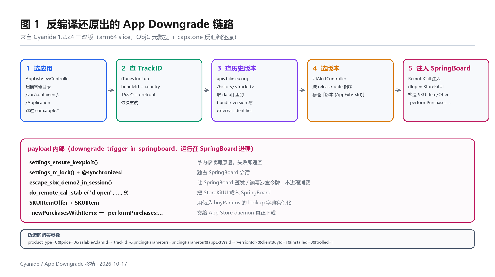
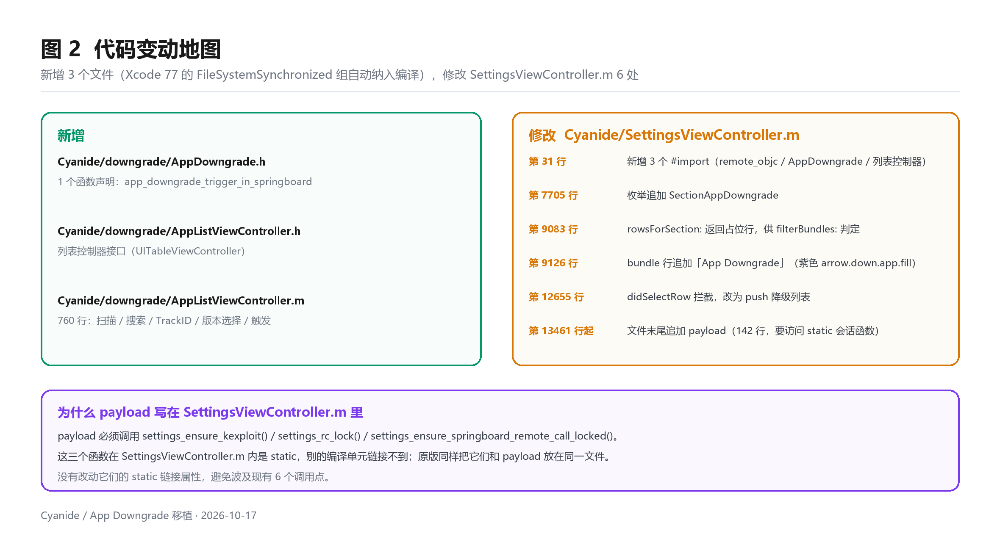
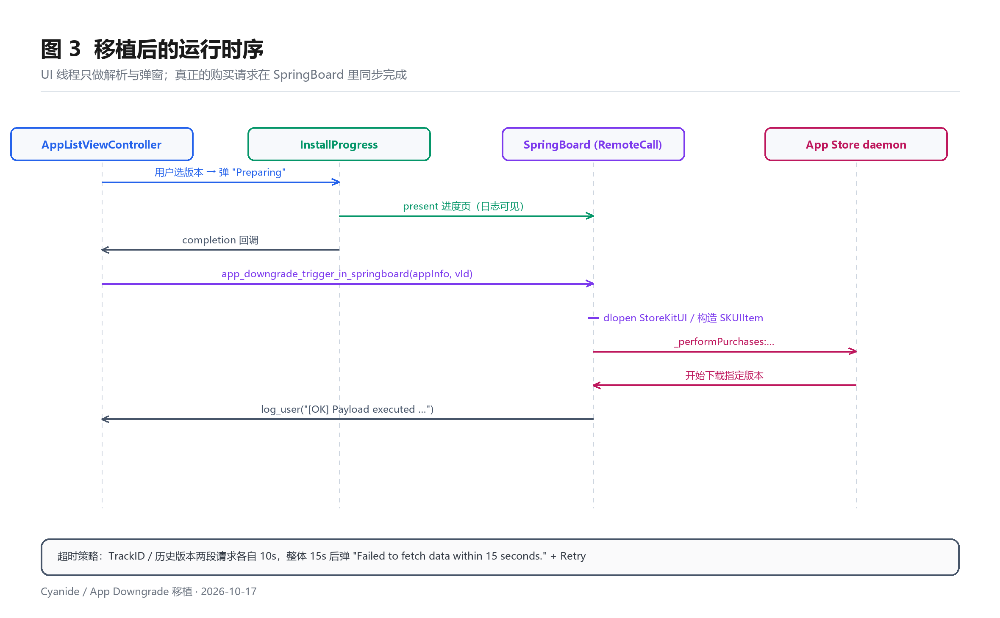

# App Downgrade 应用降级 · 逆向与移植说明

- 日期：2026-10-17
- 分析对象：`C:/Users/xcrad/Documents/Cyanide-1.2.24.ipa`（二改版，`CFBundleIdentifier = com.zeroxjf.ios-cyanide1`，1.2.24 / build 1002024）
- 移植目标：`0xjohnnydev/cyanide` main 分支（原仓库 `zeroxjf/cyanide` 已改名为 `0xjohnnydev/cyanide`，同一仓库）
- 结论：**二改版多出来的「App Downgrade」是一个完整功能模块，上游 main 完全没有这段代码**（`git tree` 里没有任何 downgrade / storekit 源文件）。已按反汇编结果重写并接入上游设置页。

---

## 0. 一句话结论

降级不是改安装包，而是**在 SpringBoard 里伪造一次「购买指定历史版本」的请求**：
用 iTunes 接口把 `bundleId → trackId`、再用第三方历史接口把 `trackId → 各版本 AppExtVrsId`，
最后把 `salableAdamId + appExtVrsId` 塞进 `buyParams`，构造 `SKUIItem` 交给 `SKUIItemStateCenter`
发往 App Store daemon。App Store 会正常下载该版本，覆盖安装即完成降级。



---

## 1. 分析对象与二进制情况

| 项 | 值 |
|---|---|
| 文件 | `Cyanide-1.2.24.ipa`（6.9 MB） |
| 主二进制 | `Payload/Cyanide.app/Cyanide`（3.0 MB，**fat**：arm64 + arm64e） |
| 加密 | `LC_ENCRYPTION_INFO_64.cryptid = 0`，**已解密**，可直接静态分析 |
| 语言 | 纯 Objective-C（无 Swift 段、无 libswift*） |
| 依赖 | `@loader_path/libxpf.dylib`（内核读写 / RemoteCall 框架）+ 系统框架 |
| 最低系统 | iOS 17.0 |
| 指针格式 | `LC_DYLD_CHAINED_FIXUPS`（`DYLD_CHAINED_PTR_64`），ObjC 元数据是 **relative method list**，方法名经 `__objc_selrefs` 间接指向 |

> 注意点：这个二进制的 relative method list 里 `nameOffset` 指向的是 **selref 槽**，不是字符串本身；
> 直接 `+ offset` 会读到一堆指针。要 `*(entry + nameOffset)` 再解引用才是选择器名。这一点花了最多时间。

---

## 2. 工具链

没有 IDA / Hopper（Windows 环境），所以自己写了三个小工具（放在 `_work/tools/`，可复用）：

| 工具 | 作用 |
|---|---|
| `macho.py` | Mach-O 解析：fat 切片、segment/section、`LC_SYMTAB`、`__objc_classlist`、class_ro_t、relative/absolute method list、category、ivar/property、chained-fixup 指针还原 |
| `fixups.py` | 解析 `LC_DYLD_CHAINED_FIXUPS`：imports 表 + 每个 `__DATA` 槽的 bind ordinal，把 `adrp x16/ldr/br` 桩还原成真实符号名（`_objc_retain`、`_dispatch_async` 等） |
| `disasm.py` | 基于 capstone 的带注释反汇编：`adrp+ldr` → 选择器 / 类引用，`adrp+add` → `__cstring` / **CFString 常量自动解码**，`bl` → 符号名 |

结果：`AppListViewController` 33 个方法、`SettingsViewController` 163 个方法全部可读；
`__cfstring` 里的 URL、键名、提示语全部还原（这是还原行为的关键，纯 `strings` 只能看到碎片）。

---

## 3. 逆向还原出的完整行为

### 3.1 入口

设置页 `SettingsViewController` 的 bundle 行列表里新增一行：

```
title = "App Downgrade"
icon  = "arrow.down.app.fill"
color = systemPurpleColor
section = 25（二改版枚举里紧跟 Home Layout Extras 之后）
```

点击时**不走**常规的「push 一个 SettingsViewController 详情页」，而是直接
`[[AppListViewController alloc] init]` 后 push（反汇编 0x10008d0ac：
`sub x8, section, #0x19; cmp x8, #1; b.hi` → 25/26 走特判，26 是 Block Updates）。

### 3.2 列表页 `AppListViewController`

| 项 | 还原值 |
|---|---|
| 标题 | `Select App to Downgrade` |
| 行高 | 60 |
| 右上按钮 | `UIBarButtonItemSystemItemRefresh` → 重新扫描 |
| 搜索框 | `UISearchController`，placeholder `Search App or Paste App Store Link`，`obscuresBackgroundDuringPresentation = NO`，`hidesSearchBarWhenScrolling = NO`，`definesPresentationContext = YES` |
| 图标缓存 | `NSCache`，`countLimit = 100` |
| 本地 App 扫描 | 枚举 `/var/containers/Bundle/Application/*/*.app`，读 `Info.plist`，取 `CFBundleIdentifier` / `CFBundleDisplayName`（回退 `CFBundleName`）/ `CFBundleShortVersionString`，**跳过 `com.apple.*`** |
| 分组 | 不搜索 1 段（Local Installed Apps）；搜索时 2 段（`Local Installed Apps` + `App Store Search (Install directly)`） |
| 单元格 | `AppCell`，`UITableViewCellStyleSubtitle`，占位图 `app.dashed` |

### 3.3 网络接口（全部还原自 `__cfstring`）

```
查 TrackID（按 bundleId）
  https://itunes.apple.com/lookup?bundleId=%@&limit=1&media=software&country=%@

按数字 id 查（粘贴 App Store 链接时）
  https://itunes.apple.com/lookup?id=%@&country=%@

关键词搜索
  https://itunes.apple.com/search?term=%@&entity=software&limit=25&country=%@

历史版本
  https://apis.bilin.eu.org/history/%lld
```

- 每个请求 `timeoutInterval = 10`。
- 按 bundleId 查询时**遍历 158 个 storefront**（顺序固定，`cn`、`us` 在最前），命中即停。
  158 个码是从 `__objc_arrayobj` 静态数组里解出来的（`0x100108b70`，count=158）。
- 历史版本接口返回 JSON，取 `data[]`，每条用到三个键：
  `release_date`（排序用，倒序）、`bundle_version`（显示）、`external_identifier`（= AppExtVrsId，真正的版本号）。
- 错误文案：`No historical versions found.`（`NSError` domain `Downgrade`，code 404）、
  `App not found in supported App Store regions.`、`Could not fetch the Track ID for this app.`、
  `Failed to fetch data within 15 seconds.`（整体 15 秒超时 + Retry）。

### 3.4 选版本

`UIAlertController`：标题 `Select Version`，正文 `Choose a version to downgrade to`，
按 `release_date` 降序，每个按钮标题 `%@ (%@)` = `bundle_version (external_identifier)`。
点中后进入 payload。

### 3.5 「Downgrade/Install Method」二选一

本地 App 和搜索结果点击后都会弹这个 ActionSheet：

- `Fetch from Server` → 走 iTunes + 历史接口自动取版本列表
- `Custom Version ID` → 手输 AppExtVrsId，提示文案 `Enter the numeric AppExtVrsId for the version:\ne.g., 843219482`，输入框 placeholder `Version ID`
- `Cancel`

### 3.6 payload：`downgrade_trigger_in_springboard(appInfo, versionId)`

这是整个功能的核心，反汇编在 `0x10009a440`（block）与 `0x10006c1f0`（外层，`dispatch_async` 到全局队列）。
执行序列**逐步**如下（顺序不能换）：

1. `log_session_begin()`，打印 `[DOWNGRADE] Requesting downgrade (Track: %lld, Version: %lld)...`
2. `settings_ensure_kexploit()` 失败 → `[DOWNGRADE] Failed: kernel primitives not acquired.` 直接返回
3. `settings_rc_lock()` + `@synchronized`，再 `settings_ensure_springboard_remote_call_locked()`
   失败 → `[DOWNGRADE] Failed to attach to SpringBoard.`
4. `escape_sbx_demo2_in_session()`：让 SpringBoard 签发 `/` 的 `com.apple.app-sandbox.read-write` 令牌，
   本进程 `sandbox_extension_consume` 消费。返回 0 = 成功（日志 `Sandbox extension consumed by SpringBoard.`），
   否则 `[WARN] Sandbox escape failed or already active (%d).`
5. `dlopen("/System/Library/PrivateFrameworks/StoreKitUI.framework/StoreKitUI", 9)` 在 SpringBoard 里执行，
   随即 `free` 掉路径字符串。失败 → `SpringBoard failed to dlopen StoreKitUI.`
6. 构造 `buyParams`（**一字不差**）：

   ```
   productType=C&price=0&salableAdamId=<trackId>&pricingParameters=pricingParameter
   &appExtVrsId=<versionId>&clientBuyId=1&installed=0&trolled=1
   ```

7. 在 SpringBoard 堆里 `malloc` + 写入 7 个 C 字符串，再用 `NSString stringWithUTF8String:` 转成远端 NSString：
   `trackId 字符串`、`buyParams`、`"iosSoftware"`、`"buyParams"`、`"_itemOffer"`、`"_itemKindString"`、`"_versionIdentifier"`。
8. `NSNumber numberWithLongLong: versionId`
9. 两个字典：
   - `{ "buyParams": buyParams字符串 }` → 给 `SKUIItemOffer`
   - `{ "_itemOffer": trackId字符串 }` → 给 `SKUIItem`
10. `[[SKUIItemOffer alloc] initWithLookupDictionary:offerDict]`、`[[SKUIItem alloc] initWithLookupDictionary:itemDict]`，
    任一为 nil → `[DOWNGRADE] ERROR: Failed to instantiate SKUI items.`
11. 对 item 连发三次 `setValue:forKey:`：
    `_itemOffer = offer`、`_itemKindString = "iosSoftware"`、`_versionIdentifier = @(versionId)`
12. `SKUIClientContext.defaultContext`、`SKUIItemStateCenter.defaultCenter`
13. `NSArray arrayWithObject:item` → `_newPurchasesWithItems:` 得到 purchases
14. 打印 `[DOWNGRADE] Sending purchase request to App Store daemon...`，
    调 `_performPurchases:hasBundlePurchase:withClientContext:completionBlock:`（参数：purchases, 0, context, nil）
15. `free` 掉 7 个远端字符串，打印 `[OK] Payload executed via RemoteCall! Please check your Home Screen for the downloading App.`
16. `log_session_end()`，主线程 `postNotificationName:@"SettingsActionsDidCompleteNotification"`

> 这套「dlopen StoreKitUI + 伪造 SKUIItem + _performPurchases」是 App Store 降级类工具的通行做法
> （AppStore++ 系同源思路），差别只在参数拼装细节。

### 3.7 调用 payload 之前会先弹进度页

`executeCustomDowngradeWithAppInfo:versionId:` 的实际流程（反汇编 0x10006d790 + 0x10006d93c + 0x10006da88）：

1. 读 `CFBundleIdentifier`、`CFBundleDisplayName`（回退 `CFBundleName`、再回退 bundleId）
2. 弹 `Preparing` / `Fetching Track ID for %@...`
3. present 完成回调里：
   - 有 `PreFetchedTrackID`（来自搜索结果）→ 直接用它，dismiss 弹窗
   - 否则 `downgrade_fetchTrackIDForBundleID:` 现查
4. dismiss 后 **present `InstallProgressViewController`（包一层 UINavigationController）**，
   在 present 完成回调里才真正调用 payload —— 这样 payload 的 `log_user` 行能实时出现在进度页上。

---

## 4. 移植实现

### 4.1 新增文件（3 个）

```
Cyanide/downgrade/AppDowngrade.h              21 行   1 个函数声明
Cyanide/downgrade/AppListViewController.h     15 行   控制器接口
Cyanide/downgrade/AppListViewController.m    760 行   扫描 / 搜索 / TrackID / 历史版本 / 版本选择 / 触发
```

工程用的是 Xcode `objectVersion = 77` 的 **PBXFileSystemSynchronizedRootGroup**，
`Cyanide/` 目录下新增文件会自动进编译，**不需要改 project.pbxproj**（已确认 exceptions 里没有排除新目录）。

### 4.2 修改点（`Cyanide/SettingsViewController.m`，6 处）



| 行 | 改动 |
|---|---|
| 31–33 | 新增 `tweaks/remote_objc.h`、`downgrade/AppDowngrade.h`、`downgrade/AppListViewController.h` 三个 import |
| 7705 | `SettingsSection` 枚举追加 `SectionAppDowngrade`（放在 `SectionCount` 前） |
| 9083 | `rowsForSection:` 增加该 section 的占位行（`filterBundles:` 靠 `count > 0` 决定是否显示 bundle） |
| 9126 | `allTweakBundleRows` 追加「App Downgrade」行（紫色，`arrow.down.app.fill`） |
| 12655 | `didSelectRow` 在 bundle 分支拦截该 section，改为 push `AppListViewController` |
| 13461 起 | 文件末尾追加 payload 函数 `app_downgrade_trigger_in_springboard`（142 行） |

### 4.3 为什么 payload 写在 SettingsViewController.m 里

payload 需要调三个函数：

```c
static BOOL     settings_ensure_kexploit(void);                          // 2699 行
static NSObject *settings_rc_lock(void);                                  // 1702 行
static BOOL     settings_ensure_springboard_remote_call_locked(void);      // 2768 行
```

它们是 **static**，别的编译单元链接不到。原版也是把它们和 payload 放在同一个编译单元里
（否则二进制里不会有 `_downgrade_trigger_in_springboard` 这个全局符号还能调到它们）。
所以这里**没有**去改它们的链接属性（会波及现有 6 个调用点），而是把 payload 追加在
`SettingsViewController.m` 末尾，函数本身是全局的，供 `AppListViewController.m` 调用。

### 4.4 关键代码

payload 主干（`SettingsViewController.m:13472`）：

```objc
void app_downgrade_trigger_in_springboard(NSDictionary *appInfo, NSNumber *versionId)
{
    dispatch_async(dispatch_get_global_queue(0, 0), ^{
        log_session_begin();
        long long trackId = [appInfo[@"trackId"] longLongValue];
        long long vid = [versionId longLongValue];
        log_user("[DOWNGRADE] Requesting downgrade (Track: %lld, Version: %lld)...\n", trackId, vid);

        if (!settings_ensure_kexploit()) { ... return; }
        NSObject *lock = settings_rc_lock();
        @synchronized (lock) {
            if (!settings_ensure_springboard_remote_call_locked()) { ... return; }
            int sbx = escape_sbx_demo2_in_session();
            ...
            uint64_t handle = do_remote_call_stable(1000, "dlopen", pathRemote, 9, 0, 0, 0, 0, 0, 0);
            ...
            NSString *buyParams = [NSString stringWithFormat:
                @"productType=C&price=0&salableAdamId=%lld&pricingParameters=pricingParameter"
                @"&appExtVrsId=%lld&clientBuyId=1&installed=0&trolled=1", trackId, vid];
            ...
            uint64_t offer = r_msg(r_msg(r_class("SKUIItemOffer"), selAlloc, 0, 0, 0, 0),
                                   selInitLookup, offerDict, 0, 0, 0);
            uint64_t item  = r_msg(r_msg(r_class("SKUIItem"), selAlloc, 0, 0, 0, 0),
                                   selInitLookup, itemDict, 0, 0, 0);
            ...
            r_msg(stateCenter, r_sel("_performPurchases:hasBundlePurchase:withClientContext:completionBlock:"),
                  purchases, 0, clientContext, 0);
        }
    });
}
```

远端调用用的是上游现成的 `tweaks/remote_objc.h`：
`r_alloc_str`（= 远端 malloc + 写入，等价原版 `downgrade_remote_alloc_str`）、`r_free`、`r_class`、`r_sel`、`r_msg`。
原版直接手写 `do_remote_call_stable(1000, "objc_msgSend", ...)`，`r_msg` 就是这层的封装，行为一致。

UI 侧触发（`AppListViewController.m`）：

```objc
- (void)runDowngradeWithAppInfo:(NSDictionary *)appInfo
                        trackID:(long long)trackID
                      versionId:(NSNumber *)versionId
{
    NSMutableDictionary *payload = [NSMutableDictionary dictionary];
    payload[@"CFBundleIdentifier"] = bundleId;
    payload[@"CFBundleDisplayName"] = appInfo[@"CFBundleDisplayName"] ?: bundleId;
    payload[@"trackId"] = @(trackID);

    InstallProgressViewController *vc = [[InstallProgressViewController alloc] init];
    UINavigationController *nav = [[UINavigationController alloc] initWithRootViewController:vc];
    nav.modalPresentationStyle = UIModalPresentationAutomatic;
    [self presentViewController:nav animated:YES completion:^{
        app_downgrade_trigger_in_springboard([payload copy], versionId);
    }];
}
```

运行时序：



---

## 5. 与原版的差异（共 3 处，全部有意为之）

1. **bundle 行位置**：原版放在 tweak bundle 列表末尾（Home Layout Extras 之后）。上游 main 已重构为
   「root 列表 + 详情页」两层结构，这里同样放在 `allTweakBundleRows` 末尾，保持位置一致。
2. **`rowsForSection:` 占位行**：上游的 `filterBundles:` 要求 `rowsForSection(section).count > 0` 才显示 bundle。
   原版没有这个检查（它的 `filterBundles:` 更早）。所以这里返回一行 `kind = info` 的说明行，
   仅用于通过筛选；点击 bundle 行时已被拦截，不会真的进到那个详情页。
3. **本地 App 单元格副标题**：原版写的是 `[NSString stringWithFormat:@"%", bundleId]`，
   格式串只有一个 `%`，实际渲染出来就是一个 `%`（明显是笔误）。
   这里按意图显示 `bundleId (v版本号)`。这是唯一一处**没有**逐字照抄的地方，特此记录。

---

## 6. 验证情况（重要）

已验证：

- 新文件 `tree-sitter-objc` 语法解析 **0 error**；修改后的 `SettingsViewController.m`
  与上游原文件的 error 数一致（都只有 1 个，来自 tree-sitter 对 `NS_ENUM(...) { ... }` 宏的已知不支持，不是真错误）。
- 括号配平（剥离字符串/注释后）通过。
- 所有调用的外部符号在上游都存在：`do_remote_call_stable`、`r_alloc_str`、`r_free`、`r_class`、
  `r_sel`、`r_msg`、`escape_sbx_demo2_in_session`、`log_user`、`log_session_begin/end`、
  `InstallProgressViewController`。
- 158 个 storefront 码、所有 URL、JSON 键名、`buyParams`、`SKUI` 类名/选择器均逐条对齐反汇编。

**未验证**（Windows 上没有 Xcode，也没有真机）：

- 未实际编译（`xcodebuild` 未跑）。
- 未在越狱设备上跑通端到端降级。
- 目标设备 iOS 版本与 `StoreKitUI` 私有类是否仍存在，取决于系统；上游声明支持 iOS 17+。

---

## 7. 如何复现这次反编译

```bash
# 1. 解包
unzip Cyanide-1.2.24.ipa -d _work/ipa

# 2. 反汇编单个方法（带选择器/CFString 注释）
python _work/tools/disasm.py AppListViewController downgrade
python _work/tools/disasm.py SettingsViewController ""

# 3. 查某函数的所有调用点
python _work/tools/xref.py _downgrade_trigger_in_springboard

# 4. 语法自检
python _work/tools/parsecheck.py Cyanide/downgrade/AppListViewController.m
```

反汇编产物在 `_work/re/`：`applist.txt`（列表页全量）、`settings.txt`（设置页全量）、
`payload.txt`（payload block）、`blocks.txt` / `blocks2.txt`（网络回调与解析 block）。

---

## 8. 遗留事项

- `_work/` 是分析用临时目录（含解包后的 IPA、上游源码副本、反汇编文本），交付时可整体删除；
  `_work/tools/` 里的四个脚本建议保留，后续再遇到 IPA 可以直接用。
- 若上游以后改回单层设置页结构，`rowsForSection:` 的占位行可以去掉。
- 该功能依赖内核原语与 SpringBoard RemoteCall，**没有**这些前提时只会打日志失败，不会崩。
